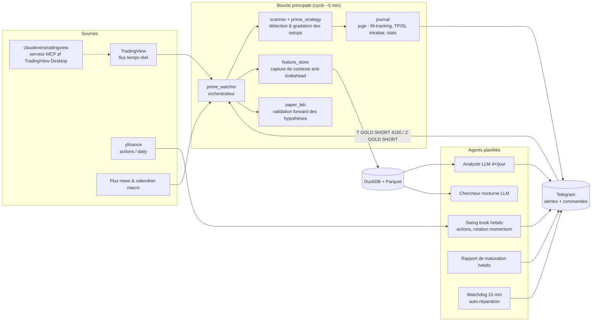

# Prime Engine

Plateforme personnelle d'agents et d'automatisation appliquée aux marchés (or et S&P 500), **signal-only** : le système analyse, décide, alerte et mesure — l'exécution reste humaine.

Le moteur tourne 24h/24 sur un poste Windows, orchestré par une dizaine de tâches planifiées. Chaque brique suit la même grammaire que les orchestrateurs de workflows (n8n, Power Automate) : **déclencheur → traitement → contrôle → action → journalisation → gestion d'erreur** — sauf qu'ici la chaîne est codée en Python, ce qui permet des règles métier plus fines et une mesure statistique honnête à chaque étage.

```
Telegram (mobile) ◄──── alertes, briefings, verdicts ────┐
Telegram (mobile) ────── commandes T / Z ────────────►   │
                                                      PRIME ENGINE (Windows, 24/7)
TradingView ──── flux temps réel + pont MCP ────────►    │
yfinance ─────── actions & données daily ───────────►    │
                                                      DuckDB / Parquet (mémoire du système)
```

## Architecture



## La chaîne d'automatisation

Chaque flux du système est un workflow autonome, déclenché par le temps ou par un événement :

| Déclencheur | Workflow | Traitement | Action / sortie |
|---|---|---|---|
| Cycle ~5 min | `prime_watcher` | scan multi-actifs, gradation des setups (A_SETUP / WATCH / NO_TRADE), vetos, capture de features | alerte Telegram si setup, ligne DuckDB, export Parquet atomique |
| Message Telegram `T GOLD SHORT 4150` | `telegram_inbox` | parsing 100 % code (aucune entrée ne touche un LLM), capture du contexte de marché à l'instant exact du trade | accusé + verdict de discipline `edge_zone` en retour |
| Message Telegram `Z GOLD SHORT` | `telegram_inbox` → `edge_zone` | évaluation pré-trade contre les statistiques personnelles apprises | verdict DANS TA ZONE / MARGINAL / DÉRIVE, avec les raisons chiffrées |
| Prix touche une entrée annoncée | `journal` (juge) | fill intrabar sur bougies 1 min, gestion cross-source, TP/SL/expiry | statut du signal + statistiques recalculées |
| Lundi 14 h | `swing_book` | règles de sortie (EMA, trailing, durée), scoring momentum de ~77 actions, caps sectoriels, benchmarks | message « ACHÈTE X / VENDS Y » + suivi book vs QQQ vs univers équipondéré |
| 4×/jour | session analyste (LLM en CLI, permissions bornées) | lecture du journal, des événements et du contexte macro ; propositions dans `research/` uniquement | résumé Telegram, rapport versionné |
| 23 h 30 | chercheur nocturne (LLM) | mining d'hypothèses sous protocole (déflation, registre, juge) | verdicts dans `research/`, jamais en production directe |
| Toutes les 15 min | `watchdog` | fraîcheur du dernier cycle réel, présence du process, espace disque | relance automatique + alerte si silence anormal |
| Dimanche 20 h | `maturation_report` | compteurs vers le prochain modèle, carte d'edge, avancement du paper-lab | briefing Telegram |
| Coupure de courant / crash | superviseur `.bat` (boucle) + tâche ONSTART | relance à froid, récupération WAL DuckDB | reprise sans intervention |

Le même patron partout : chaque étape loggue, chaque échec notifie, aucune erreur n'est silencieuse.

## Ponts & intégrations

- **TradingView — deux ponts.** Un flux temps réel (prix + bougies multi-timeframes) alimente la boucle principale, et [`tools/claudeverstradingview`](tools/claudeverstradingview) est un **serveur MCP** (Node.js) qui pilote TradingView Desktop via Chrome DevTools Protocol : lecture de la data window, scan multi-symboles, vérification de parité des indicateurs Pine.
- **Telegram, dans les deux sens.** Sortant : alertes de setups, briefings, rapports, alarmes du watchdog. Entrant : journal de trading en une ligne (`T GOLD SHORT 4150`) et interrogation de discipline (`Z GOLD SHORT`) — le téléphone sert d'interface au système.
- **Windows Task Scheduler + PowerShell.** Dix tâches planifiées (SYSTEM) portent l'ensemble : démarrage machine, cycles, agents, rapports. Un superviseur en boucle relance le moteur en cas de crash ; un fichier `STOP_WATCHER` permet un redémarrage propre sans élévation.
- **Agents LLM sous contrainte.** Les sessions analyste/chercheur tournent en CLI avec une deny-list de 134 règles ([`.claude/autonomous_settings.json`](.claude/autonomous_settings.json)) : elles proposent dans `research/`, ne touchent jamais à la production.
- **DuckDB + Parquet.** Base mono-écrivain (le watcher), exports Parquet atomiques pour tous les lecteurs concurrents — le pattern classique writer/readers sans verrou partagé.
- **yfinance** pour l'univers actions du book swing (~77 titres, données daily + fondamentaux).

## Les agents

Le registre complet — rôle, déclencheur, entrées/sorties, garde-fous de chaque agent — est tenu dans [`AGENTS.md`](AGENTS.md).

## Garde-fous & gouvernance

Un système qui décide doit être gouverné. Les règles ici sont mécaniques, pas déclaratives :

- **Constitution avec approbation humaine.** Les fichiers critiques (juge, stratégie, coûts, feature store) ne se committent qu'avec un jeton d'approbation à durée limitée, appliqué par un hook git ([`.githooks/pre-commit`](.githooks/pre-commit)) — un jeton, un commit.
- **Séparation proposition / promotion.** Les agents de recherche proposent, l'humain promeut. Rien ne passe en production sans validation.
- **Mesure honnête, structurellement.** Anti-lookahead à la capture (le contexte d'un trade = la dernière ligne *antérieure* au trade), unité statistique = jours distincts (jamais les lignes autocorrélées), correction de tests multiples, coûts de transaction appliqués, et test de concentration (un edge qui repose sur ses deux meilleurs jours n'est pas un edge).
- **Validation forward obligatoire.** Toute hypothèse issue du mining passe par le paper-lab (signaux journalisés, zéro capital) avant toute considération réelle. Le premier modèle entraîné a été **rejeté par son propre protocole** (AUC hors-échantillon inférieure au hasard) — c'est le comportement attendu d'un système qui se juge.
- **Robustesse opérationnelle.** Écritures atomiques (temp + rename) sur tous les états, verrou single-instance, rotation des journaux d'événements, watchdog avec relance, récupération WAL après coupure de courant.

## Structure du dépôt

```
prime_engine/
├── prime_watcher.py        # orchestrateur : la boucle principale
├── scanner.py              # détection des setups (confluence, OTE, caps ATR)
├── prime_strategy.py       # gradation, vetos, garde-fou d'espérance
├── journal.py              # le juge : fills, TP/SL intrabar, statistiques
├── feature_store.py        # capture de contexte (DuckDB), anti-lookahead
├── edge_zone.py            # discipline : verdicts appris des trades réels
├── swing_book.py           # book actions hebdo (rotation momentum)
├── paper_lab.py            # validation forward des hypothèses
├── telegram_inbox.py       # commandes entrantes (T / Z), parsing 100 % code
├── notify.py               # sortie Telegram (anti-spam, outbox)
├── watchdog.py             # surveillance + auto-réparation
├── windows/                # tâches planifiées, superviseur, wrappers d'agents
├── research/               # protocoles des agents LLM + expériences
├── tools/claudeverstradingview/   # serveur MCP ⇄ TradingView Desktop
├── .claude/autonomous_settings.json  # deny-list des agents autonomes
└── .githooks/pre-commit    # application de la constitution
```

## Démarrage

```bash
pip install -r requirements.txt
cp .env.example .env          # renseigner le bot Telegram
python prime_watcher.py       # ou installer les tâches : windows/install_tasks.bat (admin)
```

Le système est calibré pour un poste Windows (chemins, Task Scheduler, encodage) ; les modules d'analyse (`scanner`, `journal`, `edge_zone`, `swing_scanner`, …) s'utilisent aussi individuellement en CLI.

## Avertissement

Projet personnel de recherche et d'ingénierie. Rien ici ne constitue un conseil en investissement ; le système n'exécute aucun ordre.
